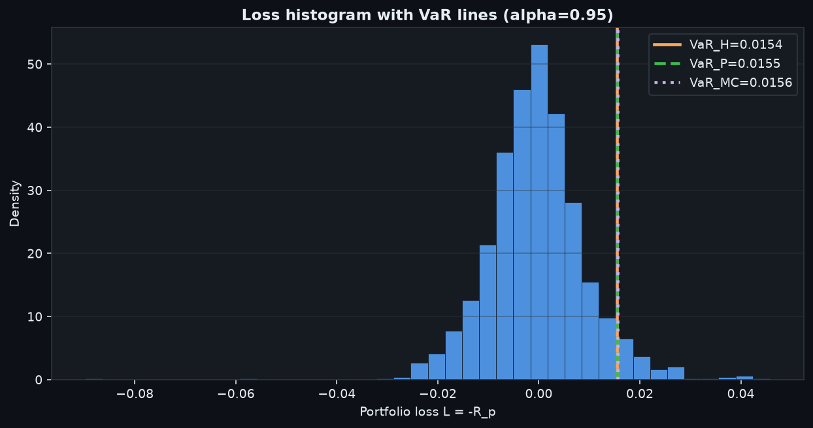
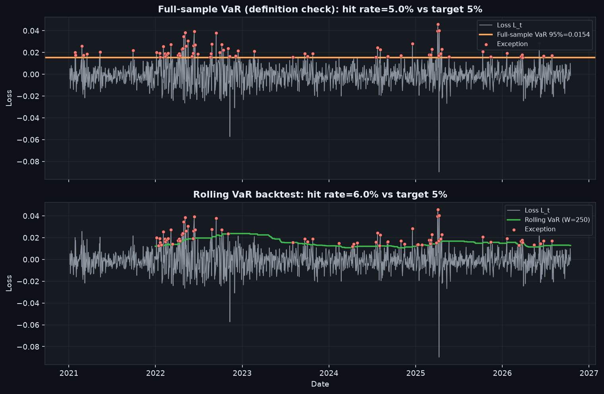
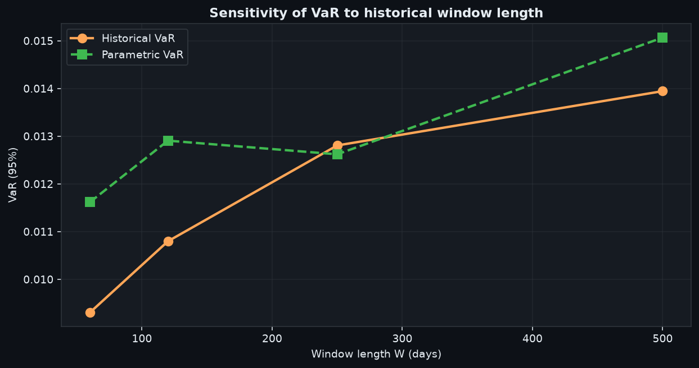
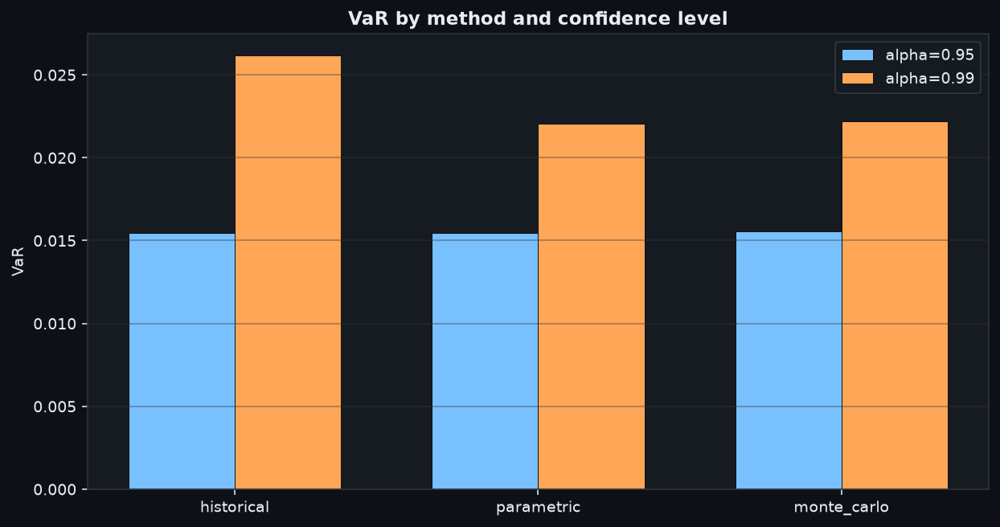
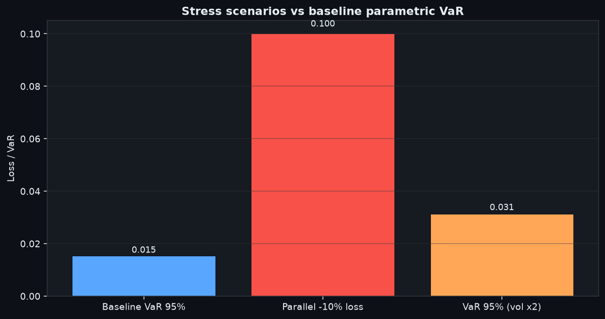

# Market Risk Engine

Educational one-day portfolio market-risk toolkit: VaR and Expected Shortfall (historical, parametric Gaussian, Monte Carlo), rolling Kupiec backtest, and simple stress scenarios. Built to be explainable out loud, not as a production bank engine.

Figures use a dark canvas aligned with GitHub’s dark theme so charts stay readable when browsing the README at night.

## Setup (Windows)

```powershell
cd C:\Users\szymo\Desktop\market-risk-engine
python -m venv .venv
.\.venv\Scripts\Activate.ps1
python -m pip install --upgrade pip
pip install -r requirements.txt
$env:PYTHONPATH = "src"
pytest -q
python scripts\run_experiments.py
```

Toggle `USE_REAL` in `scripts/run_experiments.py` (default: Yahoo Finance for SPY / QQQ / TLT, weights 50/30/20).

## Conventions

- Daily simple returns; loss \(L_t = -R_{p,t}\) (positive = loss)
- \(\mathrm{VaR}_\alpha\): loss quantile at level \(\alpha\)
- \(\mathrm{ES}_\alpha = \mathbb{E}[L \mid L \ge \mathrm{VaR}_\alpha]\)
- One-day horizon; long-only weights summing to one

## Methods in one glance

| Method | Idea |
|--------|------|
| Historical | Empirical quantile of past losses |
| Parametric | Closed form under Gaussian \(L\) |
| Monte Carlo | Simulate from fitted \(N(\hat\mu,\hat\Sigma)\), then empirical VaR/ES |

On the same book the three numbers usually differ. That is expected.

## Visual results (real data: SPY / QQQ / TLT)

### 1. Where do the three VaRs sit on the loss distribution?



At 95% the three lines almost overlap. At 99% (see table below) historical pulls ahead of the Gaussian methods: real equity/bond mix has a fatter left tail than a normal model admits.

### 2. Does “VaR 95%” really leave about 5% of days above the line?



**Top panel (full-sample historical VaR):** by construction of the empirical quantile, about **5.0%** of days sit above the orange line. Red dots are those exceptions. This panel teaches the *definition* of VaR, not an honest forecast test.

**Bottom panel (rolling VaR, window 250):** each day’s VaR uses only the past. Hit rate here was about **6.0%**. Kupiec POF does not reject 5% at the 5% level on this sample (`reject_5pct=False`). This is the panel that matches a real backtest story.

### 3. How sensitive is historical VaR to the window?



Shorter windows jump more when a crisis enters or leaves the sample. Parametric moves too, but through estimated \(\sigma_p\), so the path is smoother. Window choice is a modelling decision, not a free parameter to ignore.

### 4. VaR by method and confidence level



95% vs 99%: the gap widens in the historical column more than under Gaussian parametric/MC — again a tail story.

### 5. Stress is not VaR



A parallel −10% move on all assets is a **10%** portfolio loss, roughly **6–7×** the one-day 95% VaR. Doubling volatility roughly doubles Gaussian VaR. Quantile risk metrics do not replace scenario analysis.

## Numbers behind the plots

| alpha | method | VaR | ES |
|------:|--------|-----:|---:|
| 0.95 | historical | 0.0154 | 0.0220 |
| 0.95 | parametric | 0.0155 | 0.0195 |
| 0.95 | monte_carlo | 0.0156 | 0.0196 |
| 0.99 | historical | 0.0262 | 0.0332 |
| 0.99 | parametric | 0.0221 | 0.0253 |
| 0.99 | monte_carlo | 0.0222 | 0.0255 |

| scenario | value |
|----------|------:|
| Baseline parametric VaR 95% | ~0.0155 |
| Parallel −10% loss | 0.1000 |
| Parametric VaR 95% (vol ×2) | ~0.0314 |

## Project layout

```
src/market_risk/   # core library
scripts/           # run_experiments.py
tests/             # pytest
reports/figures/   # plots used above
```

## Limitations

- Gaussian parametric/MC understate fat tails and crash dependence.
- Historical results depend on window and which crises are inside it.
- No liquidity, credit, or operational risk; ETF proxies only.
- Yahoo Finance download required for the real-data path.
- Not a production risk system and not investment advice.
